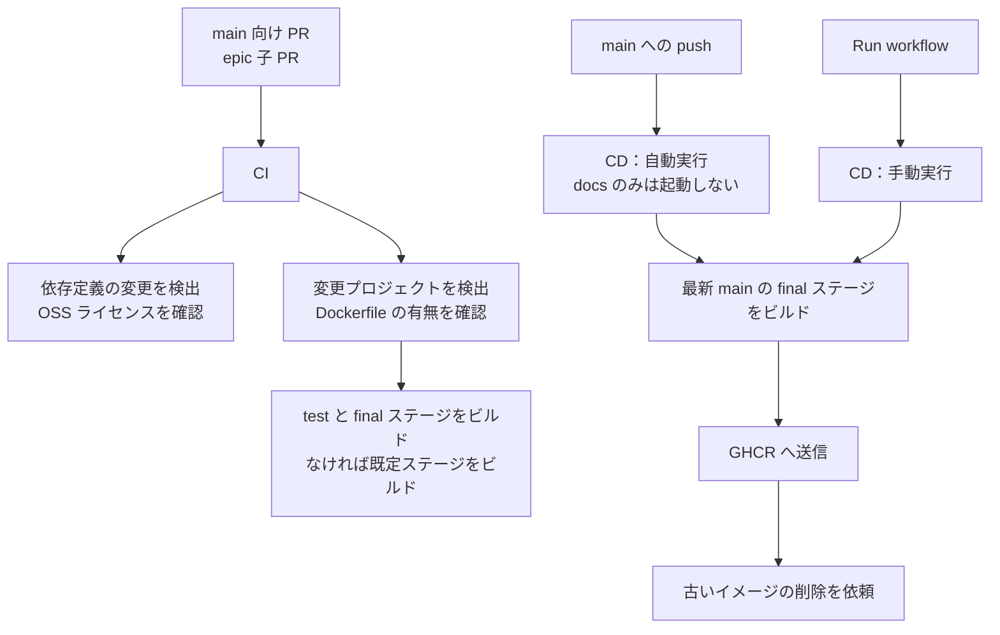

# CI/CD の仕組みと運用

このリポジトリでは、GitHub Actions を使って `projects/` 配下の Docker 対応プロジェクトを検証し、配布用イメージを GitHub Container Registry（GHCR）へ送信します。

- **CI** は `main` 向けのプルリクエスト（PR）と `epic/*` を base にする子 PR で動き、OSS ライセンスと Docker ビルドを検証します。
- **CD** は `main` への push または手動操作で動き、`final` ステージのイメージを GHCR へ送信します。`projects` 配下の `docs` だけを変更した push では起動しません。
- デプロイ先の定義は、このリポジトリでは管理しません。CD の責務は、イメージの送信と古いイメージの削除依頼までです。

## CI と CD の違い

| 項目 | CI | CD |
| --- | --- | --- |
| ワークフロー | `.github/workflows/pullrequest-check.yml` | `.github/workflows/docker-build.yml` |
| 起動条件 | `main` 向け PR、または `epic/*` を base にする子 PR の作成・更新 | `main` への push（`projects` 配下の `docs` のみを除く）、または手動実行 |
| 主な目的 | 変更内容の検証 | 配布用イメージの作成と送信 |
| Docker の対象 | `test` と `final` ステージ。存在しない場合は既定ステージ | `final` ステージがあるプロジェクトのみ |
| レジストリへの送信 | しない | GHCR へ送信する |
| イメージタグ | `ci-test` と `ci-final`（ローカルのビルド結果のみ） | 自動実行は `latest` と `sha-<short sha>`、手動実行は生成タグ（`docs` のみの push では作られない） |



## ビルド対象の決まり方

変更ファイルから、次のマーカーファイルを持つ最寄りのディレクトリをプロジェクトルートとして検出します。

- `package.json`
- `pyproject.toml`
- `Dockerfile`
- `go.mod`
- `Cargo.toml`
- `Makefile`
- `docker-compose.yaml` または `docker-compose.yml`

検出対象は `projects/` 配下です。`projects/<name>`、`projects/_labs/<name>`、`projects/_samples/<name>` の直下にマーカーファイルがある場合は、そのディレクトリを優先します。

CI と CD では、検出後の絞り込み条件が異なります。

| 実行経路 | Docker ビルドの対象 |
| --- | --- |
| CI | 変更プロジェクトのうち、ルートに `Dockerfile` があるもの |
| CD：自動実行 | 上記に加え、`Dockerfile` に `final` ステージがあるもの |
| CD：手動実行 | 入力した各ディレクトリに `Dockerfile` と `final` ステージがあるもの |

Dockerfile の基本形は次のとおりです。

```dockerfile
FROM base AS test
RUN ./run-tests.sh

FROM base AS final
COPY . .
CMD ["./start.sh"]
```

CI は `test` と `final` の両ステージを指定してビルドします。`final` は配布するイメージそのもので、`final` からしか参照しないステージ（`usage-portal` の `claude-cli` など）の検証も兼ねます。ただし、現在のビルドスクリプトは指定したステージがない場合にターゲット指定を外し、Dockerfile の既定ステージをビルドします。
一方、CD は対象検出の時点で `final` ステージの有無を確認するため、`final` ステージがないプロジェクトのイメージは送信しません。

自動実行の CD は変更の検出に push の差分を使いますが、ビルドするソースはジョブ開始時点の最新 `main` です。`Dockerfile` の有無と `final` ステージの判定も、checkout した最新 `main` の内容で行います。`projects` 配下の `docs` だけを変更した push では、ワークフロー自体が起動しません。

## CI：PR の変更を検証する

### 起動条件

`main` 向け PR と、`epic/*` を base にする子 PR の作成・更新時に `.github/workflows/pullrequest-check.yml` が起動します。
ワークフロー自体にはパスの絞り込みがないため、`docs/` だけを変更した PR でも起動しますが、対象がなければライセンスの実スキャンと Docker ビルドは行いません。

同じ PR で新しい実行が始まると、進行中の古い実行はキャンセルされます。

外部コントリビューターが fork から作成した PR では、ワークフローは自動実行されず承認待ちになります。承認が必要になる範囲はリポジトリ設定の `approval_policy` で決まり、このリポジトリでは `all_external_contributors` を設定しています。過去にマージされた変更があるコントリビューターも対象になるため、fork からの PR は常に承認が必要です。自分や Dependabot の PR はリポジトリ内のブランチから作成されるため、この設定の対象外です。

現在の設定は次のコマンドで確認できます。

```bash
gh api repos/<owner>/<repository>/actions/permissions/fork-pr-contributor-approval
```

### 処理順

1. PR のベースブランチを取得する
2. CI/CD スクリプトのテスト（変更検出、タグ生成、複数タグのビルド／push）を実行する
3. 変更ファイルからプロジェクトルートを検出し、`changed_dirs.txt` に保存する
4. 依存定義の変更からライセンスチェック対象を検出する
5. 対象があれば OSS ライセンスを確認する
6. `Dockerfile` がある変更プロジェクトを `build_projects.txt` に保存する
7. 各プロジェクトを `stage=test` でビルドする
8. 各プロジェクトを `stage=final` でビルドする
9. ビルド済み Docker イメージをログに表示する

ライセンスチェックの実行前に、必要なランタイムを対象に応じてセットアップします。Bun と uv はライセンスチェック対象があればセットアップし、pnpm は対象に `pnpm-lock.yaml` があるプロジェクトが含まれる場合だけ `pnpm/action-setup@v6` でセットアップします。

ライセンスチェックの対象や判定方法は、[OSS ライセンスチェック](./license-check.md)を参照してください。

### 失敗時に確認する箇所

- ライセンスチェックで失敗した場合は、ログの `reason_code` と対象パッケージを確認する
- Docker ビルドで失敗した場合は、検出されたプロジェクトと `Dockerfile` のステージ名を確認する
- テストが実行されていない場合は、`Dockerfile` に `AS test` があるか確認する
- `final` ステージのビルドだけが失敗した場合は、`final` の `COPY --from=` が参照するステージ名と、そこで取得する外部ファイルを確認する

## CD：イメージを GHCR へ送信する

### 自動実行

`main` への push で `.github/workflows/docker-build.yml` が起動します。ただし `projects` 配下の `docs` だけを変更した push では起動しません（`paths-ignore`）。`docs` は `final` ステージへ同梱しない方針のため、同梱が必要なファイルは `docs` 以外のディレクトリへ置きます。

1. ジョブ開始時点の最新 `main` を checkout する（push の SHA には固定しない）
2. push の `before`〜`after` の差分から変更プロジェクトを検出する
3. `final` ステージがあるプロジェクトだけを選ぶ
4. checkout した最新 `main` から `final` ステージを `latest` と `sha-<short sha>` タグでビルドする
5. `ghcr.io/<owner>/<repository>/<project>:latest` と `:sha-<short sha>` へ送信する
6. 送信したプロジェクトを対象に、古いイメージの削除を依頼する

CD は同じブランチの実行を直列に処理し、後続の push があっても進行中の実行をキャンセルしません。ただし GitHub Actions は concurrency グループ内の実行順を保証しません（FIFO で処理されますが、順序は起動時刻ではなく待機開始時刻に依存します）。そのため CD では実行順に依存しないよう、ジョブ開始時点の最新 `main` をビルド元にしています。これにより、すべての push の CD が成功すれば、最後に成功した実行で最新状態へ収束します。`projects` 配下の `docs` だけを変更した push では CD が起動しないため、その push はこの判定に含めません。

> 実行が失敗またはキャンセルされた push の変更対象プロジェクトは、後続の push が別プロジェクトだけを変更した場合や、`docs` のみの push では再ビルドされません。自動 CD が失敗したプロジェクトの `latest` を更新するには、失敗した実行を再実行するか、そのプロジェクトのコードを変更する push を行います。手動実行は `manual-*` タグだけを作り、`latest` / `sha-*` は更新しません。

### 手動実行

任意のブランチ、タグ、コミットをビルドしたい場合は、GitHub Actions から `docker-build.yml` を手動実行します。

1. GitHub Actions で **CD** を開き、**Run workflow** を選ぶ
2. **Use workflow from** は通常 `main` のままにする
3. **Git ref (branch/tag/SHA)** に、ビルドするブランチ名・タグ・コミットハッシュのいずれかを入力する
4. **Comma separated project directories** に、`projects/portal` のようなプロジェクトディレクトリを入力する
5. 複数指定する場合は、`projects/portal,projects/portfolio` のようにカンマで区切る

手動実行では、指定したすべてのプロジェクトに `Dockerfile` と `final` ステージが必要です。一つでも条件を満たさない場合は、ビルド前に失敗します。

### イメージタグ

| 実行方法 | タグ |
| --- | --- |
| `main` への push（`docs` のみを除く） | `latest`、`sha-<short sha>` |
| 手動実行 | `manual-<sanitized-ref>-<short-sha>` |

自動実行の `sha-<short sha>` は、その実行で実際にビルドした `main` のコミットに対応するタグです（`latest` と同じイメージを指します）。CD のログにはビルド元の SHA、プロジェクト、push したタグが出力されます。手動実行は入力した ref のタグだけを push し、`latest` は更新しません。`docs` のみの push では CD が起動しないため、`main` の HEAD に対応する `sha-*` タグが存在しないことがあります。デプロイでは、そのプロジェクトを最後にビルドしたコミットのタグを指定します。

手動実行のタグでは、入力した ref を小文字へ変換し、タグに使えない文字を `-` へ置換します。完了ログには、デプロイ側へ渡す値が次の形式で表示されます。

```text
image_tag=<generated-tag>
image_path=monorepo/<project-name> image_tag=<generated-tag>
```

## 古いイメージの削除依頼

GHCR への送信後、`cleanup-docker-images` アクションが `repository_dispatch` を送ります。現行の通知先は `u7chan/self-hosted-runner` です。保持数は送信先の cleanup workflow が決めるため、monorepo 側では指定しません。

```json
{
  "event_type": "deploy_local_trigger",
  "client_payload": {
    "image_path": "monorepo/portfolio,monorepo/u7chat"
  }
}
```

- `image_path` は `monorepo/<project-name>` のカンマ区切りです。
- この通知はデプロイを指示するものではなく、GHCR に保持するイメージ数の整理を依頼します。

## カスタムアクションの役割

| アクション | 入力 | 主な出力・成果物 |
| --- | --- | --- |
| `get-changed-directories` | 比較する ref（省略時は PR のベースブランチまたは `HEAD~1`） | `changed_dirs.txt` |
| `get-license-check-targets` | Git の差分 | `license_check_targets.txt`、`LICENSE_CHECK_TARGETS` |
| `get-changed-projects` | `changed_dirs.txt`、任意の `required-stage` | `build_projects.txt`、`BUILD_PROJECT` |
| `prepare-manual-build-inputs` | `projects` | 検証済みの `build_projects.txt`、`BUILD_PROJECT` |
| `set-image-tag` | イベント名、手動実行の ref | `image_tag`、`image_tags`、`commit_sha` |
| `build-docker-images` | `stage`、`image_tags` | ビルド済み Docker イメージ |
| `push-docker-images` | 認証情報、`image_tags` | GHCR イメージ、`project_names_csv` |
| `cleanup-docker-images` | `project-names-csv` | 削除処理を始める `repository_dispatch` |

`build-docker-images` は、checkout したソースの短縮コミットハッシュを `COMMIT_HASH` ビルド引数として渡します。プロジェクトルートに `pre-docker-build.sh` がある場合は、Docker ビルドの前に実行します。

## アクション依存の固定

ワークフローが使う外部アクションは、`.github/workflows/actions.lock` で特定のコミットに固定しています。ワークフロー上は `actions/checkout@v6` のような読みやすい ref のままですが、実際に実行されるのはロックファイルに記録されたコミットです。ロックファイルには直接使うアクションだけでなく、それらが依存する推移的依存も記録されます。

- `.github/workflows/actions.lock` は手で編集せず、`gh-actions-lock` で再生成する。生成時に、ワークフロー内の ref は解決済みの具体的なバージョン（例: `@v6` から `@v6.1.0`）へ書き換えられる。
- アクションやワークフローを追加・変更したら、同じ PR でロックファイルを更新する。

  ```bash
  gh extension install github/gh-actions-lock
  gh actions-lock --ignore-local-actions
  ```

- `.github/workflows/actions-lock-verify.yml` が PR と `main` への push で `gh actions-lock --verify` を実行し、ロックファイルが古い場合は失敗する。
- Dependabot がアクションを更新する PR では、ロックファイルも同じ PR で更新される。
- ロックファイルの差分は依存更新としてレビューする。`commit` の変更は実行されるコードの変更、`owner_id` / `repo_id` の変更は参照先リポジトリの変更を意味する。
- リポジトリ内の composite action は `./` 参照のままにしている。手動 CD は入力された ref を checkout するため、`$/` に変えると実行されるアクションの世代が変わってしまう。
- reusable workflow、コンテナイメージ、ランナーイメージはロックファイルの対象外とする。

## トラブルシューティング

### ビルド対象が空になる

1. 変更ファイルが `projects/` 配下にあるか確認する
2. プロジェクトルートにマーカーファイルがあるか確認する
3. プロジェクトルートに `Dockerfile` があるか確認する
4. CD の場合は、`Dockerfile` に `AS final` があるか確認する
5. push の差分基点（`github.event.before`）を解決できない場合、CD は対象 0 件で成功扱いにはならずエラーで停止するため、ログの `cannot resolve` を確認する

### docs のみの push で CD が起動しない

`projects` 配下の `docs` だけを変更した push では、CD は意図的に起動しません。デプロイが必要な場合は、そのプロジェクトを最後にビルドしたコミットの `sha-*` タグを指定するか、CD を手動実行して `manual-*` タグを作ります。手動実行は `latest` を更新しません。

### `:latest` がどのコミットのイメージか確認する

CD のログにビルド元の SHA（`build_source_sha=`）と push したタグが出力されます。イメージ側では `sha-<short sha>` タグで同じイメージを取得できます。`docs` のみの push では `sha-*` タグが作られないため、その場合はそのプロジェクトを最後にビルドしたコミットのタグを使います。

```bash
docker pull ghcr.io/u7chan/monorepo/u7agent:sha-<short sha>
docker image inspect ghcr.io/u7chan/monorepo/u7agent:sha-<short sha> --format '{{.Config.Env}}'
```

`COMMIT_HASH` を埋め込んでいるプロジェクト（`u7agent` など）は、イメージの `COMMIT_HASH` でもビルド元のコミットを確認できます。

### 外部コントリビューターの PR で CI が始まらない

fork からの PR は承認待ちで停止します。PR の **Files changed** で **Awaiting approval** を開き、**Approve workflows to run** を選ぶと実行されます。承認されないまま 30 日経過した実行は削除されます。

### 手動実行で意図した ref を使えない

ビルド対象のソースは **Use workflow from** ではなく、**Git ref (branch/tag/SHA)** の入力値で決まります。入力した ref がリポジトリに存在するか、綴りを含めて確認してください。

### GHCR への送信に失敗する

- `PRIVATE_REPO_TOKEN` が設定されているか確認する
- トークンで GHCR へログインし、イメージを送信できるか確認する
- ログに表示されたイメージ URI とタグが、ビルド時の値と一致しているか確認する

### 古いイメージの削除が始まらない

- `PRIVATE_REPO_NAME` が通知先リポジトリを指しているか確認する
- `PRIVATE_REPO_TOKEN` で通知先リポジトリへアクセスできるか確認する
- `push-docker-images` の `project_names_csv` が空でないか確認する
- `cleanup-docker-images` のログに `Cleanup trigger sent successfully.` があるか確認する
